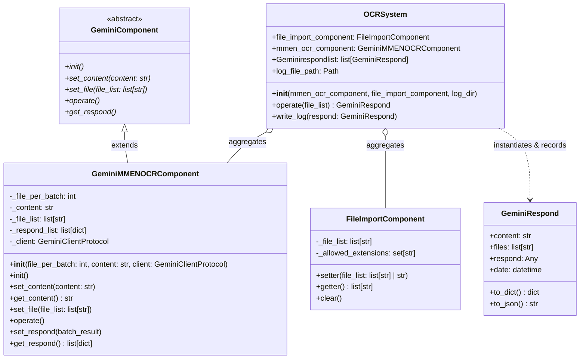

# Gemini Myanmar-English OCR Backend: Project Explanation & Guide

Welcome to the **Gemini Myanmar-English OCR Backend**! This document explains the architecture, design decisions, data flow, and code structure of this project so any developer can quickly understand, run, and extend it.

---

## 1. Project Overview

This project is a high-modularity backend system engineered for Optical Character Recognition (OCR) focusing on **Myanmar (Burmese)** and **English** text using Google Gemini (`gemini-3.5-flash-lite`).

It was built strictly adhering to the client system specification located in [`client_system_design/`](file:///c:/Users/ASUS/Desktop/customapps/Gemini_ocr/client_system_design) (`orc_system_design.jpg` and `orc_system_excl.csv`), while elevating the design into production-grade, clean Python code.

### Core Capabilities:
- **Mixed Myanmar & English Recognition**: Transcribes Burmese script, English text, and mixed multilingual documents with high fidelity.
- **Batch Processing**: Configurable image batching (`file_per_batch`) to optimize throughput and stay within Gemini API limits.
- **Deterministic 1-to-1 Mapping**: Uses Gemini Structured Outputs (JSON Schema) to guarantee that every image in a batch maps to its own separate, structured transcription record.
- **Offline Mock Capability**: Includes a complete `MockGeminiClient` so team members can develop, test, and run the pipeline without needing an active API key or internet access.
- **Automatic Resilience**: Features exponential backoff retry for transient network issues and Google API rate limits (`429`, `503`).
- **Audit Logging**: Automatically writes every OCR run to persistent JSON Lines logs (`logs/gemini_ocr_log.jsonl`).

---

## 2. Architecture & Design Diagram Mapping

The code directly reflects the client's original UML diagram:



### Component Breakdown

| Original Client Component | Implemented File | Purpose |
| :--- | :--- | :--- |
| `FileImportComponent` | [`src/gemini_ocr/components/file_import.py`](file:///c:/Users/ASUS/Desktop/customapps/Gemini_ocr/src/gemini_ocr/components/file_import.py) | Ingests, validates, deduplicates, and filters image paths (`.png`, `.jpg`, `.jpeg`, `.jpe`, `.webp`, `.bmp`). Supports folder expansion. |
| `GeminiComponent` | [`src/gemini_ocr/components/base_gemini.py`](file:///c:/Users/ASUS/Desktop/customapps/Gemini_ocr/src/gemini_ocr/components/base_gemini.py) | Abstract base class establishing polymorphism and contract for all Gemini services. |
| `GeminiMMENOCRComponent` | [`src/gemini_ocr/components/mmen_ocr.py`](file:///c:/Users/ASUS/Desktop/customapps/Gemini_ocr/src/gemini_ocr/components/mmen_ocr.py) | Myanmar-English OCR implementation. Handles chunking into batches, API call retries, and result normalization (`set_respond()`). |
| `GeminiRespond` | [`src/gemini_ocr/models.py`](file:///c:/Users/ASUS/Desktop/customapps/Gemini_ocr/src/gemini_ocr/models.py) | Immutable response record holding the prompt, files, response payload, and generation timestamp. |
| `ORCSystem` / `OCRSystem` | [`src/gemini_ocr/system.py`](file:///c:/Users/ASUS/Desktop/customapps/Gemini_ocr/src/gemini_ocr/system.py) | The coordinator uniting file import, OCR execution, in-memory history, and JSONL file persistence. |

---

## 3. Key Design Patterns Used

1. **Dependency Injection & Protocol Abstraction (`GeminiClientProtocol`)**:
   Instead of tightly coupling `GeminiMMENOCRComponent` to network requests, an adapter pattern is used. It supports:
   - `RealGeminiClient`: Calls Google's official `google-genai` SDK using `gemini-3.5-flash-lite`.
   - `MockGeminiClient`: Generates realistic synthetic responses for offline testing and unit tests without consuming API quota.

2. **Template Method Pattern**:
   `GeminiComponent` defines the lifecycle (`set_content` -> `set_file` -> `operate` -> `get_respond`), allowing other specialized OCR or multimodal components to be created easily in the future.

3. **Orchestrator / Facade Pattern**:
   `OCRSystem` encapsulates the complexity of the internal components. Callers only need to invoke a single method: `system.operate("path/to/images")`.

---

## 4. End-to-End Execution Flow

When `system.operate("sample_images")` is called:

```
[User Input] -> Single File, List of Files, or Directory Path
       │
       ▼
1. FileImportComponent.setter()
   - Resolves full paths & checks file existence.
   - Filters out non-image files (e.g. .txt, .pdf).
   - Deduplicates paths.
       │
       ▼
2. FileImportComponent.getter()
   - Returns clean list of image paths: ['test_2.jpe', 'text.png'].
       │
       ▼
3. GeminiMMENOCRComponent.set_file()
   - Stores files in component queue.
       │
       ▼
4. GeminiMMENOCRComponent.operate()
   - Splits files into chunks of size `file_per_batch`.
   - For each chunk:
     * Calls Gemini with structured schema enforcing JSON output.
     * Retries automatically if transient rate limits (429, 503) occur.
     * Calls `set_respond()` to flatten batch outputs into 1 record per image.
       │
       ▼
5. Create GeminiRespond
   - Packages `content` (prompt), `files`, and `respond` (results).
       │
       ▼
6. Storage & Logging
   - Appends to `system.Geminirespondlist`.
   - Appends JSON line to `logs/gemini_ocr_log.jsonl`.
```

---

## 5. Quickstart Guide (For New Users & Teammates)

### Step 1: Clone & Setup Environment
Ensure Python 3.10+ is installed:
```powershell
# Create and activate virtual environment (optional but recommended)
python -m venv venv
.\venv\Scripts\Activate.ps1

# Install dependencies and editable package
pip install -r requirements.txt
pip install -e . --no-deps
```

### Step 2: Configure API Key (Optional for Live Mode)
1. Copy [`.env.example`](file:///c:/Users/ASUS/Desktop/customapps/Gemini_ocr/.env.example) to `.env`:
   ```powershell
   Copy-Item .env.example .env
   ```
2. Open `.env` and paste your Gemini API key from [Google AI Studio](https://aistudio.google.com/apikey):
   ```env
   GEMINI_API_KEY=your_actual_key_here
   GEMINI_MODEL=gemini-3.5-flash-lite
   ```
> *If you do not have an API key, don't worry! You can run everything in mock mode using `--mock`.*

### Step 3: Run Tests
Run the automated test suite (all 15 tests should pass):
```powershell
python -m pytest -v
```

### Step 4: Run OCR via CLI
To test with your actual images:
```powershell
# Single image (PNG):
python scripts/run_ocr.py --input sample_images/text.png

# Single image (JPE):
python scripts/run_ocr.py --input sample_images/test_2.jpe

# Entire directory:
python scripts/run_ocr.py --input sample_images/

# Offline mock mode (No API key needed):
python scripts/run_ocr.py --mock --input sample_images/
```

### Step 5: Check the Output Log
All OCR operations are persistently recorded in JSON Lines format in:
[`logs/gemini_ocr_log.jsonl`](file:///c:/Users/ASUS/Desktop/customapps/Gemini_ocr/logs/gemini_ocr_log.jsonl)

---

## 6. How to Use in Your Own Code

You can import and use the system directly in any Python script or web framework (e.g. FastAPI / Flask):

```python
from gemini_ocr import OCRSystem

# 1. Initialize system
ocr = OCRSystem()

# 2. Process image(s)
response = ocr.operate("sample_images/text.png")

# 3. Read extracted results
print(f"Processed at: {response.date}")
for item in response.respond:
    print(f"File: {item['filename']}")
    print(f"Language: {item['language']}")
    print(f"Confidence: {item['confidence']}")
    print(f"Text:\n{item['text']}\n" + "-"*40)
```

---

## 7. Multi-Service AI & Data Hub

The project has evolved into a modular, multi-service developer hub that maintains absolute decoupling between services:

### 1. Telegram HTML Parser Service (`src/telegram_parser/`):
- **DOM Traversal with Stateful Sender Tracking**: Telegram Desktop exports consecutive messages from the same sender in `.message.joined` containers without `.from_name`. The parser maintains state to correctly attribute messages to their author.
- **Reaction Aggregation**: Extracts emoji reactions from `.reactions .media_reactions` containers, parses reacting user initials from `.initials[title]`, and accurately computes total `reaction_count`.
- **Reply References & Media**: Detects message reply anchors (extracting parent message IDs) and media links (photos, voice messages, documents). Supports relative media preview loading for local HTML/folder imports.

### 3. Database to JSON Converter Service (`src/database_parser/`):
- **Multiple Supported Formats**:
  - **SQL Dumps (`.sql`)**: Cleans dialect-specific directives (MySQL engine clauses, `AUTO_INCREMENT`, custom comment lines) and executes DDL/DML statements within an isolated in-memory SQLite sandbox with statement-by-statement error recovery.
  - **SQLite Databases (`.db`, `.sqlite`, `.sqlite3`)**: Reads schema details via `sqlite_master` and `PRAGMA table_info`, extracting complete column metadata (types, primary keys, not null constraints) and row records.
  - **Delimited Tabular Files (`.csv`, `.tsv`)**: Detects delimiters automatically and infers column types (`integer`, `float`, `boolean`, `text`).
  - **Excel Workbooks (`.xlsx`)**: Ingests multi-sheet workbooks using `openpyxl`, treating each sheet as a distinct database table.
- **Interactive Multi-Table Viewer**:
  - Switch between database tables using interactive tabs with row count badges.
  - Column schema display showing primary key flags and detected data types.
  - Client-side real-time row search filter.
  - Configurable pagination (25, 50, 100, All rows per page).
  - Single-table and entire-database JSON copy and file download.
  - Dedicated persistent run history logged to `logs/database_parser_log.jsonl` with reload support.

### 4. YouTube Channel Data to JSON Service (`src/youtube_parser/`):
- **Live Channel Ingestion & Public Metadata Extraction**:
  - Extracts channel header, avatar, banner, verified badge, handle, subscriber count, total video count, and channel description from YouTube's public `ytInitialData`.
  - Zero external API key requirement: Uses robust desktop HTTP fetcher with consent bypassing headers and URL normalization (`@handle` -> `https://www.youtube.com/@handle/videos`).
- **Rich Video Catalog**:
  - Extracts video titles, URLs, duration (formatted string & total seconds), view counts (formatted & integer), relative published time, and 16:9 thumbnail previews.
  - Distinguishes standard videos from YouTube Shorts (`#shorts`).
- **Interactive Channel Hero & Video Catalog UI**:
  - Full-width hero banner with avatar overlay, stats pills, verified checkmark, and collapsible description.
  - Video Card Grid and Compact Table view toggle.
  - Live title search, sorting (views, duration, default), and pagination.
  - One-click copy/download for single video records or the entire channel export.
  - Audit logging to `logs/youtube_parser_log.jsonl` with full history reload.

### 5. Unified Single-Page Application (SPA):
- **Segmented Control Service Switcher**: Located in the application header, users can toggle between **Gemini OCR**, **Telegram Parser**, **Database to JSON**, and **YouTube to JSON** without page reloads.
- **Synchronized History Modal**: The top-right History button dynamically adapts to show the active service's audit history (OCR runs, Telegram conversions, Database imports, or YouTube extractions).

---

## 8. Folder Structure Summary

```
Gemini_ocr/
├── src/                      # === BACKEND (100% Core Logic - Decoupled) ===
│   ├── gemini_ocr/           # === SERVICE 1: OCR BACKEND ===
│   │   ├── __init__.py       # Package exports and compatibility aliases
│   │   ├── config.py         # Configs (model, batch size, default prompt)
│   │   ├── models.py         # GeminiRespond, OCRResultItem, BatchOCRResult
│   │   ├── system.py         # OCRSystem (ORCSystem) orchestrator
│   │   └── components/
│   │       ├── __init__.py
│   │       ├── base_gemini.py  # GeminiComponent ABC & Client implementations
│   │       ├── file_import.py  # FileImportComponent (file validation)
│   │       └── mmen_ocr.py     # GeminiMMENOCRComponent (batching & retries)
│   ├── telegram_parser/      # === SERVICE 2: TELEGRAM PARSER ===
│   │   ├── __init__.py       # Telegram parser exports
│   │   ├── models.py         # TelegramChat, TelegramMessage, ReactionItem
│   │   └── parser.py         # TelegramHTMLParser & TelegramChatConverter
│   ├── database_parser/      # === SERVICE 3: DATABASE TO JSON ===
│   │   ├── __init__.py       # Database parser exports
│   │   ├── models.py         # ColumnInfo, TableData, DatabaseExportResult
│   │   ├── parser.py         # DatabaseParser & DatabaseConverter
│   │   └── parsers/
│   │       ├── __init__.py
│   │       ├── sqlite_parser.py   # SQLite .db/.sqlite/.sqlite3 extractor
│   │       ├── sql_dump_parser.py # SQL dump in-memory execution sandbox
│   │       └── tabular_parser.py  # CSV/TSV and Excel .xlsx parser
│   └── youtube_parser/       # === SERVICE 4: YOUTUBE CHANNEL PARSER ===
│       ├── __init__.py       # YouTube parser exports
│       ├── models.py         # YouTubeChannelExportResult, YouTubeVideo, YouTubeChannelInfo
│       ├── parser.py         # YouTubeChannelParser & YouTubeChannelConverter
│       └── extractors/
│           ├── __init__.py
│           ├── html_extractor.py  # Embedded ytInitialData DOM extractor
│           └── network_fetcher.py # URL normalizer & HTTP fetcher
│
├── frontend/                 # === FRONTEND & MIDDLEWARE ===
│   ├── app.py                # FastAPI middleware bridge (routes for all 4 services)
│   ├── static/               # Single-page web assets
│   │   ├── index.html        # Clean, modern 4-service single-page UI
│   │   ├── app.js            # Reactive UI, drag & drop, tab navigation, fetch API
│   │   └── style.css         # Typography & styling (Burmese font support, dark theme, cards)
│   └── uploads/              # Isolated staging directory for uploaded files
│
├── scripts/                  # === LAUNCHERS & UTILITIES ===
│   ├── start_web.py          # Script to launch the Frontend Web App
│   ├── run_ocr.py            # Standalone CLI runner with mock/live modes
│   ├── convert_telegram.py   # CLI runner to convert messages.html to JSON
│   ├── convert_database.py   # CLI runner to convert SQL/DB/CSV/XLSX to JSON
│   └── convert_youtube.py    # CLI runner to convert YouTube channel data to JSON
│
├── sample_database/          # Sample database export files for testing
│   ├── sales_database.sql    # Multi-table SQL dump (customers, sales_table, products)
│   ├── sales.db              # SQLite binary database
│   ├── sales_table.csv       # Delimited tabular export
│   └── sales_table.xlsx      # Multi-sheet Excel workbook
│
├── sample_youtube/           # Sample YouTube channel export files for testing
│   ├── sample_channel.html   # HTML export with ytInitialData
│   └── sample_channel.json   # Direct JSON export
│
├── telegram_msg_html/        # Telegram chat export files
│   ├── messages.html         # Sample input HTML chat
│   └── messages.json         # Converted output JSON
│
├── client_system_design/     # Original client requirements & diagrams
│   ├── orc_system_design.jpg # Client UML architecture diagram
│   └── orc_system_excl.csv   # Client pseudocode & class definitions
│
├── sample_images/            # Test images
│   ├── text.png              # Myanmar text sample
│   └── test_2.jpe            # Myanmar-Thai translation sample
│
├── logs/                     # Auto-created directory for JSONL audit logs
│   ├── gemini_ocr_log.jsonl       # Recorded OCR responses
│   ├── telegram_parser_log.jsonl  # Recorded Telegram conversions
│   ├── database_parser_log.jsonl  # Recorded Database conversions
│   └── youtube_parser_log.jsonl   # Recorded YouTube channel conversions
│
├── tests/                    # Pytest test suite (43 unit & integration tests)
│   ├── conftest.py           # Shared test fixtures & mock client
│   ├── test_file_import.py   # Path resolution & extension filtering tests
│   ├── test_mmen_ocr.py      # Batch division, retry & JSON unpack tests
│   ├── test_models.py        # Model serialization & alias tests
│   ├── test_ocr_system.py    # End-to-end OCR integration & logging tests
│   ├── test_frontend_api.py  # Frontend middleware routes tests (all 4 services)
│   ├── test_telegram_parser.py # Telegram HTML parser tests
│   ├── test_database_parser.py # SQL dump, SQLite, CSV, Excel parser tests
│   └── test_youtube_parser.py  # YouTube channel metadata & video tests
│
├── .env.example              # Sample environment configuration template
├── .gitignore                # Git ignore configuration protecting secrets
├── pyproject.toml            # Python packaging and IDE path configuration
├── requirements.txt          # Python dependencies
├── README.md                 # Quick reference and usage instructions
└── PROJECT_EXPLANATION.md    # In-depth architectural documentation (this file)
```

