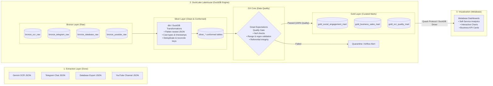
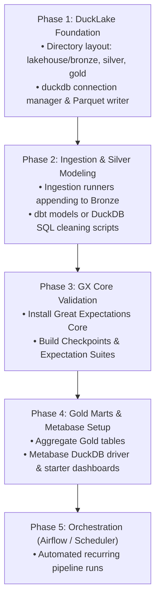

# Implementation Plan: DuckLake Medallion Data Pipeline (Bronze &rarr; Silver &rarr; GX Core &rarr; Gold)

> [!NOTE]
> **Superseded for v1 Prototype**: See [`docs/designs/ducklake_medallion_prototype.md`](docs/designs/ducklake_medallion_prototype.md) and [`docs/adr/`](docs/adr) (`0001`–`0003`) for the implemented v1 local Python DuckLake architecture across all six services.

This architectural plan outlines how to build an enterprise-grade **Lakehouse Analytics Pipeline** using **DuckLake (DuckDB-powered Lakehouse)**, transforming the raw JSON exports from our 4 ingestion services into clean, validated, and business-ready data marts for visualization in **Metabase**, orchestrated by **Apache Airflow** and modeled with **dbt** and **Great Expectations (GX Core)**.

---

## 1. Goal Description & Architecture Mapping


We have already completed the **Data Extraction Layer** (converting Image OCR, Telegram chats, Database exports, and YouTube channels into standardized JSONs). The next phase implements the central **DuckLake Lakehouse**, moving data through four distinct stages:



---

## 2. Layer-by-Layer Technical Specification

### Layer 1: Bronze (Raw Storage Layer)
- **Role**: High-throughput, immutable, append-only landing zone for unprocessed JSON data.
- **Storage**: Partitioned Apache Parquet files organized by source and ingestion date (`lakehouse/bronze/{source}/year={YYYY}/month={MM}/`).
- **Metadata Envelopes**:
  Every incoming JSON record is wrapped with Lakehouse ingestion metadata:
  ```sql
  CREATE TABLE bronze_youtube_raw (
      _ingest_id       UUID DEFAULT gen_random_uuid(),
      _ingested_at     TIMESTAMP DEFAULT current_timestamp,
      _source_file     VARCHAR,
      _batch_id        VARCHAR,
      payload          JSON
  );
  ```
- **DuckDB Native Ingestion**: DuckDB reads raw `.json` files directly at disk speed with automatic schema discovery (`read_json_auto()`) without needing Spark or external clusters.

---

### Layer 2: Silver (Clean, Standardized, Conformed Layer)
- **Role**: Flatten semi-structured JSON hierarchies, deduplicate records, enforce canonical types, and establish relational integrity.
- **Tooling**: **dbt-duckdb** (or pure DuckDB SQL macros).
- **Conformed Schemas across our 4 Services**:

#### A. YouTube Silver Models:
- `silver_youtube_channels`:
  - `channel_id` (PK, VARCHAR)
  - `channel_name` (VARCHAR), `handle` (VARCHAR)
  - `subscriber_count` (BIGINT), `total_videos_count` (INTEGER)
  - `is_verified` (BOOLEAN), `custom_url` (VARCHAR)
  - `updated_at` (TIMESTAMP)
- `silver_youtube_videos`:
  - `video_id` (PK, VARCHAR), `channel_id` (FK, VARCHAR)
  - `title` (VARCHAR), `duration_seconds` (INTEGER)
  - `view_count` (BIGINT), `published_time_text` (VARCHAR)
  - `is_short` (BOOLEAN), `thumbnail_url` (VARCHAR)

#### B. Telegram Silver Models:
- `silver_telegram_chats`: `chat_title`, `total_messages`, `export_source`.
- `silver_telegram_messages`: `message_id`, `chat_id`, `sender_name`, `message_date`, `text_content`, `reply_to_id`, `has_media`, `media_path`.
- `silver_telegram_reactions`: `reaction_id`, `message_id`, `emoji`, `reaction_count`, `reacting_users_array`.

#### C. Database Exports Silver Models:
- Conformed dimensional tables (e.g. `silver_sales_orders`, `silver_customers`, `silver_products`) parsed from multi-format `.sql`, `.db`, `.csv`, `.xlsx`.
- Normalizes disparate schemas into standardized date formats (`YYYY-MM-DD`), monetary floats (`DECIMAL(12,2)`), and ISO currency codes.

#### D. Gemini OCR Silver Models:
- `silver_ocr_extractions`: `extraction_id`, `filename`, `language_detected`, `confidence_score` (FLOAT), `raw_text`, `character_count`, `processed_at`.

---

### Layer 3: GX Core (Great Expectations Data Quality Gate)
- **Role**: Acts as a strict quality circuit-breaker between Silver and Gold. No unvalidated, corrupted, or anomalous data enters the business layer.
- **Validation Suites**:
  1. **Schema Integrity**:
     - `expect_table_columns_to_match_ordered_set`
  2. **Null & Completeness Guards**:
     - `expect_column_values_to_not_be_null` on `video_id`, `message_id`, `channel_id`, `sale_id`.
  3. **Value & Range Boundaries**:
     - YouTube: `view_count >= 0`, `duration_seconds > 0`.
     - Telegram: `reaction_count >= 0`, `message_date <= CURRENT_TIMESTAMP`.
     - Database: `order_amount > 0`, `quantity > 0`.
     - OCR: `confidence_score BETWEEN 0.0 AND 1.0`, `text_content IS NOT NULL`.
  4. **Referential Integrity**:
     - `expect_column_values_to_be_in_set` verifying foreign keys link to valid dimension records.
- **Action on Failure**: Quarantine failing records to `lakehouse/quarantine/` and trigger Airflow alert notifications.

---

### Layer 4: Gold (Business-Ready & Curated Analytics Marts)
- **Role**: Highly optimized, aggregated star/snowflake schema ready for immediate consumption by Metabase, Executive Dashboards, and Ad-Hoc SQL exploration.
- **Key Gold Marts**:
  1. `gold_youtube_video_performance_mart`:
     - Average views per duration tier (Shorts vs Long-form).
     - Daily video upload cadence and engagement metrics.
  2. `gold_telegram_engagement_mart`:
     - Top reacting participants, peak messaging hours, emoji sentiment distribution.
  3. `gold_cross_channel_analytics_mart`:
     - Unified content performance combining YouTube views, Telegram community reactions, and OCR transcription audit logs.
  4. `gold_sales_kpi_mart`:
     - Revenue by customer segment, product category, and temporal cohorts.

---

### Layer 5: Orchestration (Apache Airflow / Task Engine)
- **DAG Workflow**:
  1. `task_extract_sources`: Trigger existing loaders (`run_ocr.py`, `convert_telegram.py`, `convert_database.py`, `convert_youtube.py`).
  2. `task_load_bronze`: Append JSON payloads to DuckLake raw Parquet partition tables.
  3. `task_dbt_run_silver`: Execute Silver transformation models in DuckDB.
  4. `task_gx_validate_silver`: Run Great Expectations checkpoint suite.
  5. `task_dbt_run_gold`: If GX passes, build Gold aggregation marts and refresh columnar indexes.
  6. `task_refresh_metabase`: Notify Metabase via API to sync database schema and warm dashboard caches.

---

### Layer 6: Quack Protocol & Visualization (Metabase)
- **Quack Protocol**: Exposes DuckDB database files or DuckDB HTTP server (`duckdb-server` / `MotherDuck` / Arrow Flight SQL) so any client or BI tool can connect.
- **Metabase Connection**:
  - Connects to DuckLake using the official `metabase-duckdb-driver` (`.duckdb` file or DuckDB JDBC).
  - Native sub-second query response over millions of rows leveraging DuckDB's vectorized columnar execution engine.

---

## 3. Implementation Phasing Strategy



---

## 4. User Review Required

> [!IMPORTANT]
> **Deployment Architecture Options**:
> 1. **Option A (Lightweight Local DuckLake - Recommended to start)**:
>    - Uses Python `duckdb`, `dbt-duckdb`, and standalone `great_expectations` scripts.
>    - Zero heavy container overhead, runs entirely inside this repository, zero cloud costs.
> 2. **Option B (Full Enterprise Stack with Docker)**:
>    - Runs Apache Airflow (Docker Compose), Metabase (Docker), and DuckDB server with full web interfaces.

> [!NOTE]
> **Zero Code Modifications to Existing Ingestion Services**:
> The existing services (`gemini_ocr`, `telegram_parser`, `database_parser`, `youtube_parser`) will act as upstream data producers without changing their internal logic.

---

## 5. Open Questions for You

> [!TIP]
> 1. Would you prefer **Option A (Lightweight Python Lakehouse using DuckDB + GX Core scripts)** or **Option B (Full Docker Compose with Airflow + Metabase)**?
> 2. Are there specific business questions or metrics you want prioritized in the Gold layer (e.g. Sales KPIs, YouTube video reach, or Telegram member activity)?
